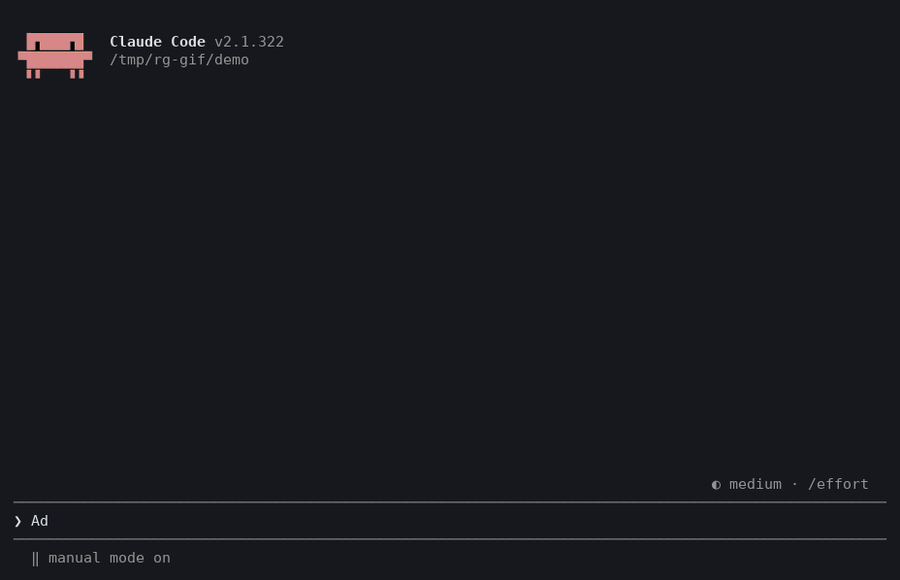

# review-guard

[](LICENSE)

A mod for Claude Code that reviews the code Claude writes and guards what it sends to GitHub. After Claude
changes code, it sends Claude back to review the change with review agents, a security check for each
language and the scanners you have installed, fix the real bugs found, and slow down on files that keep
coming back for review. Before any commit, push or GitHub write, it stops keys, tokens, IP and MAC addresses
and your personal details from going out.

<p align="center">
  
</p>

> [!TIP]
> It needs no setup to start: install it and the reviews and the GitHub check begin in your next session.
> Add your own name and email to a small config file (see [How to use it](#how-to-use-it)) so it can watch
> for those too.

> [!IMPORTANT]
> It catches common mistakes, not every leak. It knows the usual key and token formats, not every secret
> anyone could write, and a git command sent over SSH to another machine is not checked.

**[What it does](#what-it-does)** · **[What you need](#what-you-need)** · **[Install](#install)** · **[How to use it](#how-to-use-it)** · **[Help](#help)**

## What it does

- **Reviews code changes.** When a turn ends with code changed, Claude is sent back to review it with
  review agents (code review, hidden errors, test gaps), plus a short security check per language.
- **Fixes real bugs, not nits.** Claude fixes every real bug the review finds (a wrong result, a crash, lost
  or leaked data, a security hole), unsure and old ones in the changed files included. Style, wording and
  missing tests are only listed. It says why for any bug that isn't one, and leaves one unfixed only for a
  real blocker (the fix would break something, no fixed version yet, it needs your call, or it is an old
  problem in a file outside the review). Then it reruns the tests and scanners and tells you the outcome.
- **Notices when fixes keep making bugs.** When the same files of a project keep coming back for review
  (4 reviews in 24 hours by default), the review asks Claude to stop adding features to them, write tests
  that pin them down, and ask you whether their design needs another look. With the question, Claude
  says whether it recommends a redesign (yes, no or not yet), why, based on the bugs it has seen, and when
  yes, the smallest redesign that would help. You decide.
- **Checks its own file list against git (trial).** For a shell command whose writes it can't be sure of
  (a `cd`, a script or a formatter that runs, a commit), it also asks git what changed before and after,
  and keeps a note in `~/.claude/review-guard/shadow.jsonl` of where git and its own list differ. For now
  the review still uses its own list; once the notes show git is right, git's list will be used.
- **Brings its own reviewers.** It ships five review agents, so it works without the pr-review-toolkit plugin.
- **Stops leaks to GitHub.** A commit, push or GitHub write that would send a key, a token, an IP or MAC
  address, or one of your personal terms is stopped, and Claude is told what and where, never the value.
  With [gitleaks](https://github.com/gitleaks/gitleaks) installed, its key patterns are checked too.
- **Uses the scanners you have.** [bandit](https://github.com/PyCQA/bandit), [Semgrep](https://semgrep.dev),
  [zizmor](https://github.com/zizmorcore/zizmor) and [Trivy](https://github.com/aquasecurity/trivy), when
  installed and suited to the changed files. Missing ones are named, never silently skipped.
- **Knows when to wait.** If you stop Claude part way, it holds the review until Claude edits code again.
- **Checks on request.** Under **Connectors**, `check_outgoing` checks what a commit or push would send,
  `check_text` checks any text before it is posted, and `review_status` lists what is waiting for review.
  They only look, and say what kind of thing they found and where, never the value itself.

## What you need

- [Claude Code](https://claude.com/claude-code) on Windows, macOS or Linux
- [Node.js](https://nodejs.org) 22 or newer, for the Connectors tools
- `git` (and `gh` if you use it)
- For a private copy of this repository: access to it on GitHub, and git signed in to GitHub on your computer
- Optional: the scanners above. They are found on PATH, in `~/.local/bin`, or in `~/Tools/scanners/bin` and
  `~/Tools/scanners/venv` (on Windows, `%USERPROFILE%\Tools\scanners\...`, so nothing has to go on PATH)

## Install

1. In a terminal Claude Code session, type:

   ```
   /plugin install review-guard --marketplace baverrr/review-guard
   ```

2. Answer `y` to add the marketplace, then press Enter to install it for your user.

3. Start a new session. The mod is active from then on.

<details>
<summary><b>From a shell, or in the desktop app</b></summary>

- Shell: `claude plugin install review-guard --marketplace baverrr/review-guard`
- Desktop app: click **+** next to the prompt box, then **Plugins**, **Add marketplace** with
  `baverrr/review-guard`, then **Add plugin**.
</details>

## How to use it

1. **Work as usual.** When Claude changes code, the review starts by itself at the end of the turn.
2. **Commit and push as usual.** If something should not go to GitHub, the command is stopped and Claude says
   what it found and where.
3. **Ask before you share.** Say "check what this push would send" or "check this PR text for anything
   private", and Claude uses the review-guard tools. "What's waiting for review?" shows the queue.
4. **Add your own terms.** Create `~/.claude/review-guard.json` with your name, email and usernames:

   ```json
   {
     "personal": ["Your Name", "you@example.com", "yourusername"],
     "allowNetworkInfo": ["owner/notes-repo"],
     "allowValues": [],
     "churn": { "reviews": 4, "hours": 24 }
   }
   ```

<details>
<summary><b>The config file</b></summary>

| Key | What it does |
|---|---|
| `personal` | Text that must never reach GitHub (matched without regard to case) |
| `allowNetworkInfo` | Repositories, as `owner/repo`, where IP and MAC addresses are fine |
| `allowValues` | Exact values that are false alarms |
| `churn` | When files count as coming back too often: `{ "reviews": 4, "hours": 24 }` (the default), or `false` to turn it off. `reviews` is 2 to 200, `hours` above 0 |

Claude cannot edit this file; the mod stops it from trying. A typo in it stops commits until it is fixed,
except in `churn`, which then uses the default and says so in the log. While the file can't be read at
all, the churn check is skipped, so a typo elsewhere in it never turns a `"churn": false` back on.
</details>

## Help

**"review-guard could not check this command."** Git could not open the folder the command names, or the
config file has a mistake. The message gives the reason. Run git with `git -C <full path>` or fix the file.

**"It asks for a review I don't need."** These are never reviewed:

- notes and other non-code files;
- Claude's own scratch files, unless a command copies them into the project. That includes files a
  command writes after a `cd` into the scratch folder, even one spelled with `$TEMP` or `$LOCALAPPDATA`;
- a script a command only runs and leaves unchanged;
- the files named in scripts that a command only writes into the scratch folder and runs, by your choice.

A `python - <<'PY'` script that starts no program, only opens code files it names, and runs alone (nothing
else in the command runs anything) counts only those files, not every file name in its text. The status
line names each file left out. To turn the mod off for a while, set `"review-guard@review-guard": false`
under `enabledPlugins` in `~/.claude/settings.json`.

**"It checked a commit or push I didn't make."** A command that writes a file holding a git command (a test,
a note) and also runs a script is checked, since the guard can't tell whether the script runs it. A test
that only calls a helper like `git(repo, 'commit')` is not, and neither is a `python - <<'PY'` script whose
git commands are only text in its strings, as long as it imports nothing and starts no program.

**"A real address was stopped in my home-lab notes repo."** Add that repository to `allowNetworkInfo`.

**"review-guard is not under Connectors", or its tools say "out of date".** The tools need Node.js 22 or
newer on PATH. "Out of date" means the tools need rebuilding: run `node scripts/build-mcp.mjs` in the
mod's folder (Node 22.13 or newer). Then start a new session.

<details>
<summary><b>For developers</b></summary>

- The hooks are in `hooks/register.ts`, with the commit and push check in `hooks/outgoing.ts`; the scanning
  and command reading are pure functions in `hooks/scan.ts`.
- The MCP server (`mcp/server.mjs`) is set up in `.claude-plugin/plugin.json`, not a root `.mcp.json`
  (Claude would load that as a broken project server inside this folder). It runs a plain-JavaScript copy
  in `mcp/lib/`: after changing `hooks/scan.ts`, `scanners.ts`, `outgoing.ts` or `status.ts`, run
  `node scripts/build-mcp.mjs` (Node 22.13 or newer).
- How a review decides it is over, and what happens to edits made meanwhile:
  [docs/review-cycle.md](docs/review-cycle.md).
- The review agents are in `agents/`, with the same prompts in `hooks/agents.ts` for sessions that were
  already open when the mod loaded. Refresh both together (see `licenses/NOTICE.md`).
- Run the tests: `claude plugin test .` and `node --test tests/mcp-server.node.mjs`
- Check the plugin: `claude plugin validate .` and `node scripts/build-mcp.mjs --check`
</details>

## License

MIT. See [LICENSE](LICENSE).

The five agents in `agents/` are copies of the pr-review-toolkit plugin's agents by Anthropic, under the
Apache License 2.0 (`licenses/`), changed so they report every bug at any confidence (see `licenses/NOTICE.md`). Not
affiliated with Anthropic.
